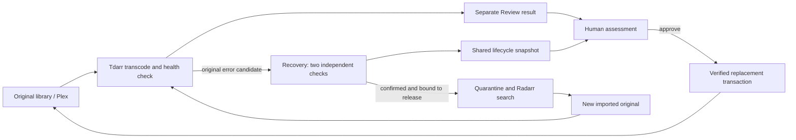

# Architecture and safety

Review is a Node HTTP server with no third-party JavaScript runtime dependencies. It reads Tdarr SQLite data and falls back to the existing Tdarr collection API for supported schemas. It calls FFprobe/FFmpeg for metadata and requested comparison samples. The browser receives no Radarr API key.

## Replacement transaction

Review stores transaction phases durably before continuing. The destination copy is verified against the Review result before replacing the original. File identities and Tdarr activity are checked again. The temporary old version and result are removed only after installation succeeds. A successful approval publishes evidence for the exact imported source and installed replacement.

On restart, only a provably untouched original can be restored automatically. Installed or ambiguous transactions remain for inspection; their journal and temporary files must not be discarded. Concurrent approvals, rejections, settings changes and preview operations are guarded by the server, not just disabled buttons.

## Automatic original recovery

The worker serializes heavy checks. It requires stable regular media, no active matching Tdarr job/result, unambiguous Radarr file/history binding and repeated matching recognized errors. Metadata fingerprints and sampled hashes must remain consistent. Sampling detects changes but is not a full-file health checksum.

After confirmation, it holds the old edition, preserves it outside the library, confirms Radarr no longer sees the old file and verifies exact release exclusion. It observes the replacement import and hands it to Tdarr. Unknown/interrupted mutation phases become manual rather than being blindly replayed.

A distinct new replacement can be diagnosed during the per-movie cooldown. A reproducible recognized error in two actual decodes of the unchanged source permits only a journaled, acknowledged Hold of that exact Tdarr file/library. It stays in the media library, and no Radarr download, release exclusion, profile change or quarantine cleanup is initiated during the cooldown. The older case retains its own quarantine and approval evidence. At the deadline, Recovery verifies the frozen source/hash/history binding and Hold again, then proceeds only when the daily limit permits. Older incomplete evidence is not silently promoted to this new contract.

Automatic replacement handoffs journal the exact imported path, fingerprint and movie-file ID. On retry, a verified existing Queued, Transcoding or terminal Tdarr record is preserved. Only an eligible Hold is released; a missing entry is scanned and read back before any queue decision. Pending transport results retain the handoff intent, while changed bindings or unsupported states require manual inspection. No remote plain-text `OK` is treated as sufficient evidence of completion.

If a newer Recovery case protects the same exact source fingerprint, an older pending handoff preserves its Hold. A missing protected record is not rescanned, since scanning could dispatch the known faulty edition again. This protection is bound to the source identity, so a genuinely different future import does not inherit the previous edition's Hold.

When no replacement is available, automatic Recovery may return the protected original via hardlink or exclusive copy while keeping the edition excluded from Tdarr. Before a later download, it validates both identities and removes only that recorded library link/copy. The quarantined original remains until the retention conditions are met.

## Shared lifecycle

Recovery atomically publishes a versioned, allowlisted status file. It includes deferred limits, verification, quarantine, release exclusion, search/download, import and the replacement's Tdarr database state. It does not publish keys or unrestricted quarantine paths.

The worker normally waits five minutes between passes. During an original decode it publishes a heartbeat every 30 seconds and coalesces measured FFmpeg progress at most every 15 seconds. Duration comes from a bounded metadata probe; unknown duration gives indeterminate progress. Each of the two passes has its own media position, elapsed time and rate-based ETA. Progress is capped below 100% until the actual exit/stderr/identity evidence is evaluated; FFmpeg `progress=end` is not health evidence.

Worker heartbeat, last decoder measurement and last Tdarr database observation have separate timestamps. A heartbeat does not refresh the timestamp of a cached imported record. Review preserves these per-case timestamps and labels snapshots older than 12 minutes as stale. Database `Queued`/`Transcoding` status is not a per-worker percentage. Status publication failure is reported separately and cannot change a source's decoding classification.

## Quarantine retention

Seven days are counted from a verified Review approval of the identified replacement, not from download, import, job success or original quarantine time. Cleanup validates approval evidence, installed file identity, the recorded quarantine identity, containment, regular files, no symlinks and appropriate hardlink count.

Only recorded eligible files are removed; unrelated quarantine contents are not recursively deleted. Unapproved replacements, unknown identities and historical cases missing evidence stay preserved. They can therefore consume space until reviewed deliberately.

## Access boundaries

All application APIs require a Review session. Mutations check browser origin. Session cookies are HttpOnly and SameSite Strict. The provided containers drop capabilities, run as an unprivileged UID, use a read-only root filesystem, and do not mount the Docker socket.

Media write access is necessary for replacement. Mounting the media parent for quarantine gives the application access to that mounted share, not only one film directory. Keep the service on a trusted LAN; this version is not hardened or independently audited for direct public Internet exposure. See [Security](../SECURITY.md).
