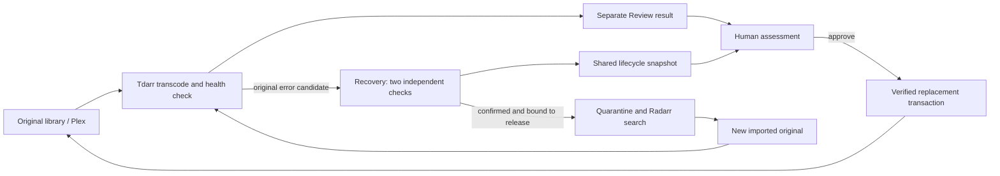

# Architecture and safety

Review is a Node HTTP server with no third-party JavaScript runtime dependencies. It reads Tdarr SQLite data and falls back to the existing Tdarr collection API for supported schemas. It calls FFprobe/FFmpeg for metadata and requested comparison samples. The browser receives no Radarr API key.

## Replacement transaction

Review stores transaction phases durably before continuing. The destination copy is verified against the Review result before replacing the original. File identities and Tdarr activity are checked again. The temporary old version and result are removed only after installation succeeds. A successful approval publishes evidence for the exact imported source and installed replacement.

On restart, only a provably untouched original can be restored automatically. Installed or ambiguous transactions remain for inspection; their journal and temporary files must not be discarded. Concurrent approvals, rejections, settings changes and preview operations are guarded by the server, not just disabled buttons.

### File identity

A file identity is the text `dev:ino:size:mtimeMs:ctimeMs` of a plain `fs.Stats` (see `GLOSSARY.md`). Journals, Recovery state, approval evidence and the frozen approval registry store it, and Recovery case IDs are hashed from it, so its bytes never change. `recovery/file-identity.mjs` is its only producer (`identityOf`) and the only place that compares two identities field by field (`compareIdentity`). The comparison returns `same`, `ctime-changed` or `device-changed` when exactly that one field differs, `different` for any other difference and `invalid` when either side is not exactly five `String()` texts of finite numbers. Each caller states which change it accepts: quarantine moves, transaction backups and library links accept `ctime-changed`, a recheck after a remount accepts `device-changed`. Exact full-text equality remains where nothing may differ.

An `invalid` recorded identity never matches. Transaction recovery leaves such a journal pending with the reason `Neplatná identita souboru v záznamu výměny.` and moves no file; replacement, retention and Recovery cases report `FILE_IDENTITY_INVALID` (unreadable recorded identity, quarantine preserved) as attention, and a changed review item is blocked with its own reason. Display-only uses (the original's location, the follow-up link) show an unknown location or no link.

### TV episode binding foundation

`review/episode-binding.mjs` resolves supplied Sonarr records into an ephemeral, instance-scoped episode-file binding with all linked episode IDs. The manual inspector in `review/sonarr-inspection.mjs` fetches saved-revision Sonarr metadata through authenticated GET-only routes and uses this resolver without storing the result. A binding is descriptive metadata, separate from filesystem file identity and any human authorisation. `review/sonarr-result-inspection.mjs` requires a fresh exact binding plus the supported receipt and successful Tdarr job before it allows `review/sonarr-result-worker.mjs` to probe the held source and result file descriptors. `review/sonarr-technical-facts.mjs` projects only bounded allowlisted metadata for the explicit `/api/sonarr/technical-facts` action; these facts do not establish health, quality, approval or replacement eligibility. [Input contract and integration limits](TV-EPISODE-BINDING.md) and the [manual inspector guide](SONARR-INSPECTOR.md) describe the boundary; TV processing remains unavailable pending #238.

### TV discovery (read-only)

`libraries.tv.mode` is `off` (default; absent means off) or `discovery`; `enabled: true` stays rejected. `review/tv-discovery.mjs` is a separate scan pass that never touches the movie `scan()`, item map or approval code. It reads the applied (not draft) settings and does nothing at all in `off` mode: no filesystem walk, no Tdarr read, no Sonarr request. In `discovery` mode it walks the TV result prefixes (`review/media-walk.mjs`, shared with the movie scan), reads each result's receipt through `resolveReviewSource`, requires the receipt `jobId`, compares the receipt's file identities with both files, and finds the exact job (TV `libraryId`, "Transcode success", source mapped through the TV source roots, sizes) with `matchReviewJob`. Results that pass these file-side checks are bound against Sonarr: one `GET /api/v3/series` locates the series whose own folder (mapped exactly through `sonarrRoot`) holds the result, then only the involved series' EpisodeFiles and Episodes are read (`createSonarrDiscoveryReader`, GET only, per-request timeout, 30 s budget) and `createEpisodeBindingResolver` must find exactly one EpisodeFile for the source path. Every other outcome is *unbound* with a fixed reason code, or *unverified* ("binding not verified") when Sonarr is not configured, unavailable, slow or inconsistent. Names are never parsed.

TV item ids are `sha256('tv\0' + reviewRelative)` (24 hex characters), so they cannot equal a movie id. Persistent state is `state.tv = {version, settingsKey, items}`, keyed by TV id; it holds only file-side evidence (relative paths, snapshot, job id, a flag that the receipt identity matched) so the receipt sample hash is not recomputed for unchanged files. A Sonarr binding is never persisted: it is kept in memory with its observation time. No movie code path reads `state.tv`; movie keys stay byte-identical (`review/tv-discovery.test.mjs` and `review/tv-http.test.mjs` snapshot them). The only movie-side change is that, while discovery is on, `scan()` skips result paths under a TV prefix.

`routes/tv.mjs` serves `GET /api/tv/status` and `GET /api/tv[?refresh=1]` only. It has no per-result route and no write method, and no TV result id is accepted by any approve, reject, replace or batch route (a TV id is not in the movie item map). The UI section (`public/tv-view.js`) renders series → season → episode and lists unbound and unverified results apart, with no action control. Strict per-episode review and approval, series-wide reconciliation and TV transactions remain separate work under #238.

### Server layout

`review/server.mjs` loads configuration and state, recovers transactions, owns discovery (`scan`), node pausing/resuming, the batch, the replacement queue and preview preparation, and runs the request pipeline. The approval/rejection transaction of one film is `review/approval-transaction.mjs`: `createApprovalTransaction` takes the server's state and configuration getters, the unresolved-transaction list and adapters for files and the journal (`safeFile`, `replaceChecked`, cleanup), Tdarr (node read, busy check, pause, pause check before the commit, rescan, resume), records (approval evidence, decision audit, rejection archive) and activity (the `active` entry and progress), and returns `perform(action, item, acceptDuration, reason)`. It starts the action before its first `await`, so the busy-policy reservation hands over without a gap. `review/approval-transaction.test.mjs` drives its ordering in-process; `review/approval-transaction-http.test.mjs` pins the same paths through the real server and a recording Tdarr mock. Every request first passes the Host check, the POST origin and JSON checks, login, authentication and, for a mutating request, the busy-policy reservation. Only then is it dispatched to the route modules in `review/routes/`:

| Module | Routes |
| --- | --- |
| `auth.mjs` | Login and session check |
| `items.mjs` | Item list, review sessions, approve, reject, batch, recheck, Radarr replacement request, review-file download |
| `previews.mjs` | Sample preparation settings and status, on-demand frames, audio and AV samples |
| `settings.mjs` | Tdarr connection and path settings |
| `library.mjs` | Posters, statistics, quarantine listing, Radarr settings, requests and restore, Recovery runtime diagnostics |
| `tv.mjs` | Read-only TV discovery status and overview |
| `static.mjs` | The fixed set of UI files in `review/public/` |

Route modules receive one explicit server-state object (`ctx`). Its getters and setters read and write the server's own variables, so the busy flags, caches and settings that routes change are the same ones used by scanning, transactions and background preparation. A route returns `true` once it has answered; `review/routes.test.mjs` checks that every route is owned by exactly one module.

### Browser UI modules

The UI in `review/public/` is a set of ES modules loaded without a build step. `app.js` holds the page state (latest data, Radarr requests, selection, navigation) and renders the item list, detail dialog, confirmations and progress. It passes one context object (`api`, `error`, `load`, `loadRequests`, `openDetail` and getters for the current state) to the feature modules:

| Module | Content |
| --- | --- |
| `ui-kit.js` | DOM and formatting helpers without application state |
| `comparison.js` | Frame and audio/AV comparison dialogs and the A/B player |
| `settings-dialogs.js` | Review, sample-preparation and Radarr settings dialogs |
| `quarantine.js` | Quarantine listing |
| `statistics.js` | Savings statistics |
| `recovery-view.js` | Recovery progress and detail renderers |
| `review-workflow.js`, `review-model.js`, `av-player.js`, `i18n.js` | Review steps, display rules, AV player and translations (unchanged) |

Every module and stylesheet URL is written as `?v=__APP_VERSION__`; the static route (`review/routes/static.mjs`) replaces the placeholder with the running app version (`APP_VERSION`, else `package.json`). A release therefore cannot mix cached old and new modules, no import needs a hand edit on a version bump, and a module is never evaluated twice under two URLs (which would split module state such as the locale in `i18n.js`). `npm run check` refuses any other `?v=` value. A new UI file must also be listed in the static asset table in `review/routes/static.mjs`.

### Concurrent application actions

`review/busy-guards.mjs` defines the server's named concurrency policies. After authentication, a mutating request reserves foreground work before reading its body, draining background previews or awaiting preflight. The reservation transfers to the existing active/batch flag when an asynchronous action starts, and releases on every response/error. An interactive preview reserves work after its body distinguishes an on-demand render from a cache-only/track-list read. Competing mutations receive HTTP 409.

| Action | Additional blockers beyond foreground work | Deliberate allowance |
| --- | --- | --- |
| Approve, reject, batch, Radarr replacement | Unresolved replacement recovery and owned node pauses | Join an existing scan for fresh preflight; the request keeps its foreground reservation while waiting. An approval confirmed while another replacement or batch runs is queued instead of refused (`state.replacementQueue`, one entry per film): when nothing else replaces media, the queue starts each entry from a fresh scan under a foreground reservation, and `perform` checks its snapshot and review revision again. Queued entries never run by themselves after a restart; they become `queueInterrupted` and need a new confirmation. |
| Quarantine restore, recheck | Scan, unresolved recovery and owned pauses | None. These change media bindings and must start from idle state. |
| Main settings save/test | Scan, statistics calculation, unresolved recovery and owned pauses | None. These may change the media/API configuration used by those operations. |
| Radarr settings save/test, preview cache settings | Scan | Remain available during unresolved recovery/owned pauses because they cannot replace media or resume Tdarr dispatch. |
| Interactive preview | Scan | May read media during unresolved recovery/owned pauses, with existing file identity validation. Not excluded by a running replacement or batch, except for the film being replaced or waiting in the batch (`item_in_operation`). |
| Saved review write, approval only | Scan, unresolved recovery and pauses left after an operation | Writes retain their revision-aware CAS queue; the queue does not exclude itself. A running replacement or batch excludes only the film it is replacing or still has to replace (`item_in_operation`); node pauses held by that operation do not count as unresolved. |

Foreground work includes active transactions, batches, node-resume requests, previews, settings and review writes. A running node resume blocks settings and interactive previews even when unresolved pauses themselves are allowed. Discovery scans persist item metadata: during foreground mutations, read requests use the previous cache (or an empty list before the first scan), and approval/rejection/replacement preflight scans use their own reservation. Scans coalesce rather than starting competing scans. Background preparation/cleanup also waits for foreground work, scans, recovery and owned pauses.

Cache-only previews and track-list reads keep their existing read-only availability. Neither can record a manual review confirmation. HTTP regression tests start the real server with temporary synthetic files/SQLite and gated loopback Tdarr/Radarr/probe/renderer fixtures; they check every mutating route, competing approvals, settings and preview overlap, scan preflight, pause restoration and unresolved recovery. The HTTP fixture suite runs on the supported Linux platform with Node 24; portable policy tests also run on Windows.

## Shared settings generations

review/shared-settings.mjs owns the durable shared draft and complete active generation in /data/shared-settings.json. Legacy settings.json, radarr.json and recovery/config.json are import/CAS inputs after activation, not competing ordinary-settings authorities. Public projections allowlist editable fields and never return credentials or historical exception values. Process-lifetime ownership (Linux boot ID and process start ticks) protects writes across PID reuse; immutable unique candidates exclude concurrent writers without stale fixed-path lock replacement.

Authenticated /api/shared-settings routes stage drafts and expose revisions/history. review/settings-apply.mjs owns the explicit asynchronous apply: read-only diagnostics, Recovery admission drain/ack, Review safe-state barrier, revalidation, stop, atomic generation commit, in-memory activation with invalidation by level and Recovery-only restart. Test reports the invalidation level of the candidate against the Review configuration in use (`review/settings-invalidation.mjs`: `none`, `samples` or `all`, with the causing Review fields and the films whose saved reviews and Approve decisions it clears). Apply requires that report, recomputes the level before draining Recovery and again under the safe-state barrier, and refuses with `settings_invalidation_changed` before stopping anything when it is stricter; the audit entry of the commit records the level, fields and the shown and cleared counts. An adopted ambiguous commit clears everything. /status and /cancel remain available while waiting. A transient finalizing state covers terminal audit/barrier release. settings-activation.json is an interruption fence, never a persistent command. On interrupted/ambiguous activation, startup uses a complete committed generation and fails Recovery closed as needed; it does not resume apply or roll back endpoints.

Review, artwork and healthcheck read the active Review/Radarr snapshot. Recovery's authority (`recovery/recovery-authority.mjs`) enforces mode first and then consumes the same generation before the existing registry/state checks. A private historical exception revocation refuses stale Recovery authority; Review's non-authorizing reader remains usable to correct settings. Off never starts a worker. Legacy startup remains unchanged until the first managed generation. No UI test, save, connection check or navigation grants film approval.

## Automatic original recovery

The worker serializes heavy checks. It requires stable regular media, no active matching Tdarr job/result, unambiguous Radarr file/history binding and repeated matching recognized errors. When only the release binding fails (missing, incomplete or conflicting import or grab in Radarr's history), the worker still runs the two original decodes, makes no change, and ends the case as `manual` with the evidence and the exact reason (`bindingFailure`, `bindingDiagnosis` in `recovery/policy.mjs`); the binder itself is never relaxed. Review then offers its manual Radarr replacement for exactly that case (`sourceCandidate` in `review/radarr-replacement.mjs`, `POST /api/recovery/cases/<id>/replace-source`): it reads Recovery's private state read-only, requires the `manual` status, a known `bindingFailure` code and two confirming decodes of the recorded identity, and binds its snapshot to the case, the Radarr movie and the unchanged original. The run is the normal manual replacement without a Review result: only the original moves to quarantine, with the usual Hold, profile, exact-title exclusion of the current file, and restore. Metadata fingerprints and sampled hashes must remain consistent. Sampling detects changes but is not a full-file health checksum. With the opt-in `fullSourceHash` setting the worker also compares a full SHA-256 taken at confirmation with one taken immediately before the quarantine rename.

After confirmation, it holds the old edition, preserves it outside the library, confirms Radarr no longer sees the old file and verifies exact release exclusion. It observes the replacement import and hands it to Tdarr. Unknown/interrupted mutation phases become manual rather than being blindly replayed.

A distinct new replacement can be diagnosed during the per-movie cooldown. A reproducible recognized error in two actual decodes of the unchanged source permits only a journaled, acknowledged Hold of that exact Tdarr file/library. It stays in the media library, and no Radarr download, release exclusion, profile change or quarantine cleanup is initiated during the cooldown. The older case retains its own quarantine and approval evidence. At the deadline, Recovery verifies the frozen source/hash/history binding and Hold again, then proceeds only when the daily limit permits. Older incomplete evidence is not silently promoted to this new contract.

Automatic daily-quota deferrals have their own frozen journal and acknowledged Hold. Later passes verify the unchanged source, sample, current Radarr binding and configured roots/library before resuming with the existing two decode results. They do not return to ordinary job/header discovery and repeat heavy checks. Capacity uses the expiration that leaves fewer active mutations than the configured limit, including cases where the current count exceeds a reduced limit. Historical frozen approvals follow their separate pending loop.

Both deferrals are one **frozen deferral** in `recovery/frozen-deferral.mjs`, parameterized by its kind: `COOLDOWN` (journal `deferredCooldown`, statuses `defer_cooldown_intent` / `deferred_cooldown`) and `DAILY_LIMIT` (`deferredLimit`, `defer_limit_intent` / `deferred_limit`). `deferConfirmed(kind, …)` journals the intent and writes and confirms the permanent Hold, `inspectDeferred(kind, …)` only reads and reports `ready`, a waiting state or `disabled`, and `reconcileDeferredIntent(kind, …)` acknowledges an interrupted intent by reads. Every kind shares the unchanged-source, binding, sample and Tdarr-row checks; the kind supplies its gate (`cooldownFor`, `quotaFor`), its journal and validation, its messages and two differences that are kept on purpose: the cooldown requires a distinct edition and always writes the Hold, the daily limit validates its journal again around the Hold and does not repeat a Hold Tdarr already holds.

`recovery/worker.mjs` is only the process: it reads and checks the configuration, state and approval registry, owns signals, the control channel and the poll loop, and calls `createWorker` in `recovery/create-worker.mjs`. The factory builds the adapters (Tdarr, Radarr, phase journal, source identity and sample, binding, idle check) once and shares them with every step; it returns `tick` (one poll), `markInterrupted` (restart handling), `noteConfigChange`, `save`, `refresh` and `close`, so tests can drive one poll in-process.

Frozen repair authority is loaded solely from persistent `/data/pending-approvals.json` before restart handling or APIs. It is bounded, schema/mapping/evidence checked and deep-frozen; semantic membership ignores object-key order while preserving evidence-array order. Missing historical authority is never reconstructed from state. An offline exclusive migration preserves exact source/state backups. Completed imported legacy metadata with a consistent original tuple can remain read-only history, but it never authorizes another repair or joins the registry automatically.

All Tdarr file-state reads and writes go through `recovery/tdarr-file-state.mjs`, shared by Recovery and Review. `read(file)` refuses a row for another file or library (when one is configured); `hold(file, until)` writes `Hold` and reads the row back, accepting only exactly `Hold` with that `holdUntil`; `queue(file)` writes `Queued` and returns the row read afterwards. `HOLD_FOREVER` is the one indefinite deadline (cooldown and daily-limit deferrals, kept sources). Every Hold is confirmed before the action it protects: an unacknowledged or missing Hold stops the cooldown or daily-limit deferral, the quarantine rename, the return or removal of a kept source, and Review's manual replacement before any file moves. Callers keep their own intent journals and never replay an unconfirmed write blindly.

Automatic replacement handoffs journal the exact imported path, fingerprint and movie-file ID. On retry, a verified existing Queued, Transcoding or terminal Tdarr record is preserved. Only an eligible Hold is released; a missing entry is scanned and read back before any queue decision. Pending transport results retain the handoff intent, while changed bindings or unsupported states require manual inspection. No remote plain-text `OK` is treated as sufficient evidence of completion.

If a newer Recovery case protects the same exact source fingerprint, an older pending handoff preserves its Hold. A missing protected record is not rescanned, since scanning could dispatch the known faulty edition again. This protection is bound to the source identity, so a genuinely different future import does not inherit the previous edition's Hold. Review's manual Radarr replacement applies the same rule (`preservesHold` in `recovery/replacement-handoff.mjs`) before it hands an imported file to Tdarr: it reads Recovery's cases from `/data/recovery/state.json` read-only. A missing state file means Recovery never ran and protects nothing; a state that cannot be read or validated keeps the handoff pending with a visible reason and never releases a Hold or rescans.

When no replacement is available, automatic Recovery may return the protected original via hardlink or exclusive copy while keeping the edition excluded from Tdarr. Before a later download, it validates both identities and removes only that recorded library link/copy. The quarantined original remains until the retention conditions are met.

The hardlink return deliberately gives the preserved source two directory entries (`nlink = 2`): one in quarantine and one in the library. Review's `safeFile()` requires `nlink === 1` for both the original and result, so any result paired with that hardlinked edition is blocked with the multiple-hardlinks reason. Manual review completion supplies no exception. An exclusive-copy fallback does not trigger this guard, but does not release Recovery's Tdarr Hold or supply approval evidence. After Recovery removes its recorded library path and Radarr imports a distinct replacement, that new source must pass the normal independent Review checks. Never weaken the hardlink guard or remove the preserved quarantine entry to make an old result approvable.

### Readers of `config.json` and the approval registry

Recovery's `config.json` (or the active managed generation) and the persistent approval registry (`pending-approvals.json`) have several readers. They must accept and refuse the same files, so they all ask one module, the **Recovery authority** in `recovery/recovery-authority.mjs`, which answers "the effective configuration and approvals, or the refusal reason":

- `readRecoveryConfiguration({data, mode, checkActivation})` checks `RECOVERY_MODE` first, then honours an interrupted settings activation (only when `checkActivation`), then returns the active managed generation through Review's `readActiveSettings`, or else `config.json` through `readRecoveryConfig` in `recovery/recovery-mode.mjs`. Review's modules are imported as `#review/*`, which the repository's `package.json` maps to `review/` and the image's `/package.json` (`tools/image-package.json`) to `/review-app/`; they are loaded only for this managed read.
- `readRecoveryRestoreBinding({data, mode})` is a separate Review-only metadata projection for the explicit original restore. It validates managed authority or the complete legacy schema (including `enabled:false` when Off) and returns only binding fields; it does not produce a runtime configuration or approval authority. It is intentionally available in Off while `readRecoveryConfiguration({mode:'off'})` continues to refuse. The reader-matrix test covers its legacy/managed Off acceptance, malformed or absent authority refusals and unchanged files.
- `readRecoveryApprovals({data, cfg, state})` loads the registry through `loadApprovalRegistry` in `recovery/approval-registry.mjs`; `authorizeRecoveryApprovals` turns its error into the `registry-refused` refusal.
- `editedConfigProblem` is the same gate for a later edit of `config.json`; `recoveryApprovalProblem` the registry and state gate for a candidate configuration in Review's settings Apply. Without a registry, the state alone still refuses: a historical approval with no registry behind it.
- `resolveRecoveryConfig({mode, text})` checks a lone `config.json` text, for the documented pre-update check.

The rules themselves stay in one place each: `recovery/recovery-mode.mjs` (mode, `enabled`, parsing; refusal reasons; exit code 78 with a final `RECOVERY_REFUSED <reason>` line), `recovery/config-values.mjs` (every required setting present, each known setting of a usable type and range, unknown keys ignored) and `recovery/frozen-config.mjs` (the registry's frozen `config` against the running configuration: exact match for every key, except that a frozen `enabled: true` also accepts Verify; also `registryAllowedModes` for the status file).

The readers that use it:

- `recovery/worker.mjs` before any state/registry/API access (`readRecoveryConfiguration`, then `authorizeRecoveryApprovals`); every poll, `processPending` in `recovery/pending-approved.mjs` compares the frozen `config` with the running one again before frozen approvals may run.
- `recovery/create-worker.mjs` (`noteConfigChange`) for a changed managed generation, and `recovery/config-watch.mjs` (`startupValidator`, through `editedConfigProblem`) for a later edit of `config.json`. The result is published as `configChange` by `recovery/live-status.mjs` and shown by Review (`review/radarr-replacement.mjs`).
- `tools/migrate-recovery-registry.mjs`, the offline migration utility, with the same `RECOVERY_MODE` and without resuming an activation; it installs the registry through `migrateApprovalRegistry`. The Review image ships it at `/tools/` beside the whole `recovery/` directory at `/recovery/`. `tools/image-layout.test.mjs` loads it and starts the worker from the files the `Dockerfile` copies, so a module or import mapping missing from the image fails `npm test`.
- Review's settings Apply and draft checks (`review/shared-settings.mjs`, through `recoveryApprovalProblem`) and Review's reader of the active generation (`readActiveSettings`), which Recovery uses strictly.
- Review's manual Recovery Radarr diagnosis (`review/recovery-attention.mjs`) reads the effective configuration through `readRecoveryConfiguration` with the actual `RECOVERY_MODE`; it does not parse a legacy `config.json` itself. Its HTTP fixture covers a managed generation with stale legacy Radarr fields and Off-mode refusal.
- The pre-update check in [Configuration](CONFIGURATION.md#check-a-configjson-before-an-update), which imports `/recovery/recovery-authority.mjs`; `tools/docs.test.mjs` runs it.
- `tools/docker-smoke.mjs` writes a synthetic `config.json` to `/data/recovery/` to start the built image in `verify`.
- The inspection command in [the 2.0 migration guide](MIGRATE-TO-2.0.md#check-what-the-old-configuration-and-registry-freeze) reads both files of a 1.11 installation and prints only key names, counts and the `enabled` flags; `tools/docs.test.mjs` runs it. A change to the registry shape or to the meaning of `enabled` updates it too.
- `examples/recovery-config.example.json` uses Review's mappings (`/media`, `/review`, `/tdarr`); `tools/packaging.test.mjs` passes it through `resolveRecoveryConfig` and `loadApprovalRegistry` in both modes.

`tools/recovery-authority-readers.test.mjs` runs one table of accept/refuse cases (legacy and managed; Off, Verify, Repair; missing, unusable or conflicting `config.json`; frozen-registry mismatch; historical approval without a registry; corrupt authority; stale private exception; interrupted activation) against every reader above that can see the case. The effective-configuration reader used by Review's diagnosis participates in this table; its HTTP fixture also checks the managed/stale-legacy and Off paths. The restore-binding projection has its own Off-mode matrix because its metadata-only purpose differs from worker admission.

## Supervisor

`review/supervisor.mjs` is the entrypoint that runs Review and Recovery in one container ([ADR 0001](adr/0001-recovery-runs-inside-review.md)). The image runs it under [tini](https://github.com/krallin/tini) (`ENTRYPOINT ["/usr/bin/tini", "--"]`, a static binary pinned by checksum), so the container needs no `docker run --init`: tini is PID 1, passes SIGTERM to the supervisor and reaps orphaned processes. The image places Review at `/review-app/`, the Recovery modules at `/recovery/` (the supervisor starts `../recovery/worker.mjs` from `server.mjs`) and the registry migration utility at `/tools/`. The supervisor always starts Review (`review/server.mjs`). When the Recovery mode (`RECOVERY_MODE`) is `off` or unset, it never starts Recovery. Any other value starts the Recovery worker (`recovery/worker.mjs`) through `ionice -c 2 -n 7` and `nice -n 19`, with `DATA_ROOT` set to `<DATA_ROOT>/recovery`, `REVIEW_DATA_ROOT` set to `<DATA_ROOT>` for read-only Review-owned restore-edition evidence, and the mode passed on unchanged. The worker itself refuses a value other than `verify` or `repair`, so the supervisor never decides that repairs are allowed.

- **Crash.** Recovery exiting for any reason other than a refusal or a stop is restarted after 10 s, doubling with each consecutive crash up to 5 minutes. From the fifth consecutive crash the state file reports `crash-loop`. A run that lasts 10 minutes resets the count. Review is never signalled or restarted because of Recovery, and a Recovery command that cannot be spawned counts as a crash.
- **Refusal.** Exit code 78 with a last stderr line `RECOVERY_REFUSED <reason>` (see [Readers of `config.json`](#readers-of-configjson-and-the-approval-registry)) is not restarted. Recovery's stderr still reaches the container log; only a reason matching `[a-z0-9-]{1,64}` is copied into the state file, anything else is recorded as `unknown-refusal`.
- **Review exits.** The supervisor cancels a pending restart, sends Recovery SIGTERM, sends SIGKILL if it is still running 8 seconds later (within Docker's default 10-second stop timeout), and exits with Review's status (128 + signal number when Review died of a signal, 127 when Review could not be started).
- **SIGTERM/SIGINT.** The first signal is forwarded to both children; a repeated one is not forwarded again, so Review's own shutdown handler is never cut short. The supervisor exits with Review's status after both have exited, with the same 8-second limit for Recovery. The handlers are in place before the first state write, because PID 1 ignores signals without a handler and the supervisor is PID 1 whenever it runs without tini. An interrupted original decode is retried, never counted as corruption evidence.

### Settings apply control

The transitions below are one pure function, `controlTransition(context, event)` in `recovery/control-protocol.mjs`: it returns the next request state, the reply and the commands (send a worker command with its failure handling, start the worker, cancel a pending restart, record a request id, wait for the worker exit) that `supervise()` executes in order. `CHANNELS` names the three IPC channels (`recovery-worker`, `recovery-control`, `recovery-control-reply`). `recovery/control-transition.test.mjs` covers every transition without spawning processes.

Review's settings coordinator uses `createRecoveryControlClient()` (`review/recovery-control.mjs`) over its inherited child-process IPC channel. The supervisor accepts commands only from its own Review child and sends worker commands over a separate IPC channel inherited through `ionice`/`nice`. There is no network control listener, Docker socket or persistent command file. Messages contain an allowlisted action, bounded request/correlation identifiers and a supervisor-instance session; configuration and API keys never travel over this protocol.

`requestDrain(id)` returns `draining` promptly. Worker admission closes between complete journaled operations, including individual case loops. The current operation finishes, state and status are flushed, and only then does the worker acknowledge `ready`. Verify mode is subject to the same admission gate, including protective restoration. `wait(id)` polls until a drain/start reaches a final state; `status(id)` reads its current state. `cancel(id)` before stopping resumes the old worker. `stopAfterDrain(id)` requires positive readiness and waits for orderly worker exit with no timeout or forced signal; disconnect still fails the caller. `restart(id)` starts only Recovery and returns `starting`, followed by `running` only after the worker validates its configuration, registry and restart reconciliation. Connectivity checks belong to the settings coordinator's pre-apply diagnostics. A refusal or exit before that startup acknowledgement becomes `failed`, with no automatic retry or rollback. Once startup succeeds, ordinary crash handling resumes.

Off remains off throughout this protocol. Requests exist only in supervisor memory; a new supervisor instance invalidates their session and never silently resumes an old drain or apply. An explicit reconcile of a matching, valid durable original-restore operation may bootstrap only that operation under a new session; unrelated or unproven requests remain refused. An abandoned stopped settings request can be replaced by a new explicit request; the old identifier then expires. Durable generation commit and interrupted-activation detection belong to the settings coordinator/store adapter and must gate initial startup separately from this volatile protocol. Container shutdown retains its existing signal and grace-period policy.

### Review's explicit original restore

`review/recovery-safe-restore.mjs` offers a separate, confirmed action for one `manual` Recovery case whose exact original remains in its recorded quarantine. The read-only eligibility request binds the operator's confirmation to the current private case, Recovery binding, quarantine identity and fresh Radarr movie/search/complete-queue and Tdarr activity reads. The mutation repeats those reads after Recovery drains and before it touches a file. An occupied original path is never overwritten, and the action never moves a Review result, writes Recovery's `state.json`, releases an unproven Hold, changes a profile or renews retention. Restoring a source Recovery had identified as faulty is neither a health result nor approval.

The restore journal and fence are Review-owned files under `<DATA_ROOT>/recovery-restores/` and `<DATA_ROOT>/recovery-restore-fence.json`; exact edition evidence is under the journal directory. They are outside Recovery's private `<DATA_ROOT>/recovery/` state. Journal and fence installs are exclusive and durable. Each closed operation is retained under its operation ID; replaying a completed or cancelled operation is read-only, and a retry needs a fresh confirmation bound to the prior operation epoch. The material case snapshot is separate from that epoch, so claiming the journal does not stale the post-drain file and service recheck. Same-filesystem restore uses an exclusive hardlink; a different filesystem uses a verified, synced temporary copy in the destination directory and an exclusive hardlink install. Journaled source and destination identities, content hashes, canonical roots and non-symlink parents must all still match before reconciliation may remove the last quarantine link. Uncertain or malformed records stay blocked and preserve every unproven copy.

The canonical Recovery authority checks the durable fence before both supervisor admission and worker configuration/API access. A matching restart is allowed only for the restore operation that Review just fenced and explicitly authorized after the filesystem result was proven. Verify/Repair returns to its recorded mode; `off` remains off. A stopped worker is not treated as a successful restart merely because Review sent an IPC request. On an interrupted request, the journal reports the file and worker outcomes separately. Explicit reconciliation can adopt only the matching valid restore operation; it never adopts an unrelated settings request or a new supervisor session. The exact restored-edition evidence is read-only to Recovery, scoped to the exact current file identity and stable library binding, and confers no repair approval or health status. A changed edition does not inherit the exception.

Images predating the restore fence and edition evidence do not understand those files. Do not run an older image with Recovery enabled while a restore journal/fence is pending, and keep Recovery Off when reverting to an image that lacks this protocol; otherwise that worker may ignore the fence or reconsider the restored source. Leave pending Review-owned restore journals and fences intact until returning to a compatible image and reconciling the recorded operation. This downgrade guidance is durable because release packaging removes changelog fragments.

### One container, shared mappings

Up to 1.11.0 Recovery ran in its own container with its own `/data`, the media parent at `/storage` and read-only `/review` and `/reports`. Since 2.0.0 it shares the Review container, its user (UID 99:100) and Review's mappings; there is no separate Recovery image or Compose service. Its data root is `/data/recovery/` (`config.json`, `state.json`, the private `pending-approvals.json` and caches). Recovery may write only there, to the shared status file `.tdarr-recovery-status.json` in the parent of its media root, to the original-language cache, to quarantine and through the library operations it already performs; never to `/review` or elsewhere in `/data`. With the container boundary gone, this is a convention guarded by tests, not by mounts ([ADR 0001](adr/0001-recovery-runs-inside-review.md)).

Review imports the modules it shares with Recovery straight from `recovery/` (for example `file-identity.mjs`, `download-queue.mjs`, `quarantine-retention.mjs` and the Tdarr handoff `replacement-handoff.mjs`) instead of keeping copies. The image installs Review at `/review-app/` and Recovery at `/recovery/`, so a `../recovery/` import resolves the same way in the repository and in the container.

Frozen approval evidence is never rewritten to fit the new defaults. An installation migrated from the separate container keeps its frozen `/storage` roots by mapping `/storage` to the same host folder as `/media`, so Review and Recovery still address the same files and status file ([2.0 migration](MIGRATE-TO-2.0.md)).

### Recovery runtime state file

The supervisor publishes `<DATA_ROOT>/recovery/runtime-state.json` (mode 0600) at start and on every change. Each write goes to a temporary file that is synced and renamed over the old one, followed by a directory `fsync`, so a reader never sees a partial file. A write failure is logged and never affects Review. The file holds exactly these fields and never contains configuration values, keys or other stderr text:

| Field | Value |
| --- | --- |
| `version` | `1`. A change of meaning or removal of a field needs a new version. |
| `mode` | `off`, `verify`, `repair`, or `invalid` for any other `RECOVERY_MODE` value. |
| `state` | `off` (mode is off; Recovery is never started), `running`, `restarting` (waiting for the next start after a crash), `refused` (exit 78; no automatic restart) or `stopped` (Review exited, the container is stopping, settings drained the worker, or apply startup failed). During settings apply the control protocol's `starting`/`running` states supply explicit startup readiness; this informational file reports `running` at spawn. |
| `restarts` | Number of restarts since the supervisor started. |
| `lastExitCode` | Exit code of the last Recovery exit, or `null` (never exited, killed by a signal, or could not be spawned). |
| `lastExitSignal` | Signal name such as `SIGKILL` that ended the last Recovery run, or `null`. |
| `lastStartedAt`, `lastExitedAt` | ISO 8601 times of the last start and exit, or `null`. |
| `reason` | `null`, or a reason code: `crash` (restarting after a crash), `crash-loop` (five or more consecutive crashes, reported while restarting and running until a run lasts 10 minutes), the refusal reason (for example `missing-config`, `mode-conflict`, `invalid-mode`, `registry-refused`, or `unknown-refusal`), `review-exited`, `shutdown`, `settings-apply` (orderly drained stop), or `apply-start-failed` (worker exited during drain/apply without a refusal). |
| `updated` | ISO 8601 time of this write. |

### Review's view of Recovery's files

Review reads three Recovery files and never writes them: the runtime state above, the shared status file `.tdarr-recovery-status.json` beside the media root, and the case state `/data/recovery/state.json`. `review/recovery-snapshot.mjs` is the only reader of each and gives one verdict: absent, valid (with its content) or invalid (with a value-free reason). The status file is valid only as a regular file of at most 2 MB holding a JSON object with `version: 1`, a `cases` list and a readable `updated`; the case state only as a JSON object with a `cases` object. Health (`recoveryStatusHealth`), the replacement overview and restart notice, the manual replacement's Hold handoff and `/api/recovery/runtime` project from these verdicts: an invalid status file is `recovery-status-stale` attention in health and an error in the overview; an invalid case state blocks the handoff, an absent one protects nothing. `review/recovery-snapshot-readers.test.mjs` runs one table of file contents against every reader.

### Needs attention model

`review/recovery-attention.mjs` adds, to every case that `classifyRecovery` (`review/public/review-model.js`) puts in Needs attention, an `attention` object in `GET /api/radarr/requests`:
- `reason`: the code of the classification path;
- `location`: `library`, `quarantine`, `review`, `tdarr` and `radarr`, each `verified`, `unverified` or `not-used`, with a state code and, for Tdarr and Radarr, whether Recovery reported it or Review read it;
- `recommended`, `actions` (each with what it changes) and `blockers`.

The library and quarantine states compare the files recorded in Recovery's case state with their current file identity. A Review result is linked only when its recorded original identity is the file in the library now. Recovery's Tdarr and Radarr reports count as verified only while its status is fresh. `POST /api/recovery/refresh` (all attention cases, or the given case keys) reads the Tdarr row and Radarr again; a failed read is `unverified`. For an import-blocked or failed-queue Recovery case, the refresh additionally verifies the private case/movie binding and Recovery's effective Radarr namespace through the Recovery authority, then reads the exact Radarr movie and its bounded, complete queue page. It emits only an allowlisted diagnosis category and safe movie/Activity URLs; a generic queue failure is not treated as an import failure, and incomplete, ambiguous, stale or failed reads are `unavailable`. Opening the overview never makes these external reads, and a refresh result is not reused by a later overview or restart. The attention projection does not write Recovery files, Tdarr, Radarr, media or retention state. The separate `review/recovery-deferrals.mjs` stores notes under Review's `data/recovery-deferrals/`, namespaced by source and case ID. Only a freshly bound Recovery attention case with a safe current file identity or a safely verified missing file may be deferred. The material fingerprint includes the effective Review library mappings and the canonical Recovery binding read through its authority. Opaque revisions and a per-case serialized compare-and-write protect defer/reopen mutations. The fingerprint includes the stable attention reason, phase, private case bindings and live file identities, but omits status timestamps and progress. On an overview, a missing or changed binding durably changes a deferred Review record to `invalidated`; this Review-only tombstone keeps the case visible even if the old phase later returns. Invalid records never hide attention. The note is exposed only in the authenticated Review response and rendered as text; it is never copied to Recovery state, shared public status, logs or exports. Deferral state does not replace `classification` or the server's underlying action list, and it grants no media-action authority. A parent whose verified follow-up still has unresolved work gets `supersededBy` and is classified as done; the follow-up carries the attention.

The Diagnostic export (`review/diagnostic-export.mjs`, `GET /api/cases/{recovery|radarr}/{id}/diagnostic-export`, behind the normal authentication and Host/origin policy) is separate from the attention projection. It reads the local overview, the Recovery case file and the deferral record without a fingerprint (so it never invalidates or writes a deferral) and never calls `attach`, `refresh`, Tdarr or Radarr. It emits only fixed tokens chosen by allowlists, validated timestamps and the requested identifier; unknown values become `unrecognized`, and a missing, inconsistent or concurrently changed case record is reported as such (`caseRecord`, `completeness`) with `verification: not-verified`. A malformed identifier is refused before any read; the source namespace is part of the lookup. The response is `Cache-Control: no-store` with an attachment filename built from the validated identifier. `exportDiagnostic` is the server-listed attention action (`changes: nothing`); it grants no media authority.

For a `retention-error` attention, the same overview adds `retentionDiagnosis` with a value-free reason code. `review/recovery-retention-diagnosis.mjs` rebinds Recovery cases through `readRecoveryCaseState` and obtains Recovery's effective roots through `readRecoveryRestoreBinding`; in Off mode this is the metadata-only binding reader, so it does not start or control the worker. Review-owned imported cases are read from their bounded replacement journal. The approval evidence file is checked at its existing derived location with a bounded no-follow read, exact replacement binding and the installed-copy identity; quarantine paths and recorded identities are checked against the existing retention roots. Content identity must match exactly for an approved copy: a ctime-only change gets a distinct metadata-only reason and is never called healthy or approved. Recovery case/config and approval evidence are re-read before returning a verified diagnosis. Missing, changed, mismatched, or malformed evidence receives a specific allowlisted reason; unreadable files, unsafe paths/parents and stale bindings remain unavailable. The UI gives the existing refresh action and an administrator next step. It does not renew approval, change a deadline, delete quarantine or write Recovery state. Recovery's public status adds a boolean `retentionErrorPresent` alongside its existing error field. The Review retention-attention response redacts raw error fields and sets that safe presentation marker only after the matching private case is verified, including for Review-owned replacement journals.

### Tdarr handoff of an imported replacement

`review/tdarr-handoff.mjs` (#231) reads the Tdarr row of a `replacement_imported` case's replacement. The Tdarr path is the case file's source root plus `replacementRelative`. When no Tdarr state is reported and the row is verifiably missing, the attention model sets `tdarrMissing`, and `classifyRecovery` makes the case attention (`tdarr-missing`).

The handoff is eligible only when all of these hold:
- the case is under Review's `mediaRoot`;
- the library ID is set and Recovery's runtime is readable and not `verify`;
- the file is a plain single-link file with the recorded identity and was last modified more than 10 minutes ago;
- the row is missing, with no job since the import and no busy worker;
- no mutation is running.

A Hold, protected (`preservesHold`) or not, is a blocker; Review never queues or releases a Hold.

`POST /api/recovery/cases/<id>/handoff` runs under the `replace` busy policy and needs `confirm: true` and the view's snapshot:
1. it writes the intent to `data/recovery-handoffs/<case>.json` with a directory fsync;
2. it calls `rescan-file` for that exact file;
3. only a fresh row read confirms the handoff and completes the journal.

An intent without confirmation is `uncertain`, and a retry needs `acknowledgeUncertain: true`. A `manual` case after a failed Recovery handoff gets the `handoff-manual` blocker only, because Recovery runs retention only for `replacement_imported` cases.

### Retry of a failed transcode

`review/transcode-retry.mjs` (#232) handles a `replacement_imported` case whose Tdarr row is `Transcode error` or `Not required`. Path and file-identity helpers shared with the other Recovery readers are in `review/recovery-case-paths.mjs`. The Tdarr writes go through `recovery/tdarr-file-state.mjs`.

Cause classification reads the Tdarr job report of the newest error job for exactly the replacement's Tdarr file and classifies it with Recovery's rules in `recovery/policy.mjs` (`classify`):
- decode damage: no retry; Recovery's own job scan opens its own case for the damaged file;
- operational (permission, I/O, disk space, memory, network): retry offered;
- unrecognized: retry offered, labelled "cause not recognized";
- unreadable report: unverified, no retry.

The view carries only the cause category and, for decode damage, the recognized decoder message with numbers and addresses masked. It carries no paths and no full report; export is a later issue (#237).

The retry is eligible only when all of these hold:
- file identity is the recorded replacement, a plain single-link file;
- the row is still `Transcode error`;
- the newest job for the file is that error job and ended after the import;
- no Tdarr worker processes the file;
- the Tdarr library ID is set, Recovery's runtime is readable and not `verify`;
- no other Review action is running.

`POST /api/recovery/cases/<id>/retry` runs under the `replace` busy policy and needs `confirm: true` and the view's snapshot (`GET` returns the view). It runs in this order:
1. it writes the intent to `data/recovery-retries/<case>.json` with a directory fsync, once per replacement identity;
2. it calls Tdarr `bulk-update-files` to set `TranscodeDecisionMaker` to `Queued`, and reads the row back through `queue()`;
3. only a read-back `Queued` or `Transcoding` confirms the retry. Otherwise the intent is `uncertain`, and a further attempt needs the user to confirm that Tdarr was checked.

If the retried transcode fails again, no further retry is offered and the view says to inspect Tdarr. Retries do not count toward `maxRepairsPerDay`. Nothing in the library moves and the quarantine is kept.

For `Not required` there is no retry, since Tdarr would skip the file again by the same rules. The case instead offers the installed-copy assessment for the untranscoded replacement (see below), when the Tdarr row is `Not required` for that exact file and the job history has a `Not required` decision after the import. The view sets `untranscoded` so that the disclosure says the copy was not transcoded.

### Assessment of an installed result

`review/installed-assessment.mjs` handles a `replacement_imported` case without approval evidence whose transcoded result already replaced the imported replacement in the library (#230). Eligibility is computed from fresh reads:
- the case in Recovery's `state.json`, under Review's own `mediaRoot`;
- no evidence file (`approvalEvidencePath`);
- one plain, single-link file at the replacement path or with the same name and another video extension, whose identity differs from the replacement's;
- the Tdarr row of that file in `Transcode success`;
- a successful `jobsjsondb` job for it that ended after the replacement's recorded modification and change times;
- no Review item for the same path, and no running mutation.

Any read failure is `installed-unverified`. The attention model offers `assessInstalled` and then never `restore`.

In the `Not required` mode (#232), the same assessment covers the untranscoded imported replacement itself: the file must be the replacement's own identity, the Tdarr row must be `Not required` with a `Not required` decision after the import instead of the success row and job, and the view carries `untranscoded: true` so that the disclosure says the copy was not transcoded.

The assessment is Review-owned:
- the draft lives in `data/recovery-assessments/<case>.json` (device, explicit boolean checks, note), bound to a token of the current file identity; a changed file voids it;
- approval (`POST /api/recovery/cases/<id>/installed/approve`, `confirm: true`, the `replace` busy policy) re-checks eligibility and completeness (the device and HDR rules of `review/public/review-rules.js`);
- it then calls `publishApproval` keyed by the imported replacement, with the current file as the installed copy, and records `installed-approval` in the decision audit.

Recovery's existing `retainCase` then sets the deadline. Review never writes Recovery's files.

## Shared lifecycle

Recovery atomically publishes a versioned, allowlisted status file. It includes deferred limits, verification, quarantine, release exclusion, search/download, import and the replacement's Tdarr database state. It does not publish keys or unrestricted quarantine paths.

The worker normally waits five minutes between passes. During an original decode it publishes a heartbeat every 30 seconds and coalesces measured FFmpeg progress at most every 15 seconds. Duration comes from a bounded metadata probe; unknown duration gives indeterminate progress. Each of the two passes has its own media position, elapsed time and rate-based ETA. Progress is capped below 100% until the actual exit/stderr/identity evidence is evaluated; FFmpeg `progress=end` is not health evidence.

Worker heartbeat, last decoder measurement and last Tdarr database observation have separate timestamps. A heartbeat does not refresh the timestamp of a cached imported record. Review preserves these per-case timestamps and labels snapshots older than 12 minutes as stale. Database `Queued`/`Transcoding` status is not a per-worker percentage. Status publication failure is reported separately and cannot change a source's decoding classification.

### Verify pause and original location

The waiting-source path gates only replacement requests/source removal on `cfg.enabled === false`; its protective restoration and read-only import observation continue. Import observation records current metadata while preserving a paused handoff phase. The worker gates Tdarr handoff and quarantine retention separately. No mutation plan or release selection is persisted for use after a pause; Repair re-enters the existing identity, queue/movie, Tdarr and approval checks.

The version-1 public case projection adds `verifyPausedStep` (`replacement_request`, `tdarr_handoff`, `quarantine_purge`, or `null`), `originalOutsideLibrary` (boolean, or `null` when location cannot be checked), `originalOutsideSince`, and `originalRestoredAt`. They are allowlisted by the live publisher, retained in linked followups and passed to Review's case API and Recovery view. No paths or configuration values are included. The pause marker is derived from the active mode and current phase, never repair authority. Location checks compare both the recorded library source and quarantine identities, including a restored copy/link. A differently named replacement does not imply the old original vanished; missing or changed quarantine is shown as unknown location.

New library removals and restorations record their location times in the private journal. For old quarantined cases that never recorded restoration, the original mutation start is the historical fallback; after an observed restoration, an unknown later removal time remains unknown. Snapshot publication does not advance these timestamps. Review derives one health attention from them (`recovery-original-outside-library`, a fresh status with a paused `replacement_request` whose original has been outside the library for more than `RECOVERY_ORIGINAL_OUTSIDE_MS`, 24 hours, in `review/public/review-model.js`, shared by the health summary and the Recovery view). They never change the health check result or approval.

## Quarantine retention

Seven days are counted from a verified Review approval of the identified replacement, not from download, import, job success or original quarantine time. Cleanup validates approval evidence, installed file identity, the recorded quarantine identity, containment, regular files, no symlinks and appropriate hardlink count.

Only recorded eligible files are removed; unrelated quarantine contents are not recursively deleted. Unapproved replacements, unknown identities and historical cases missing evidence stay preserved. They can therefore consume space until reviewed deliberately.

## Access boundaries

All application APIs require a Review session. Mutations check browser origin. Session cookies are HttpOnly and SameSite Strict. The provided containers drop capabilities, run as an unprivileged UID, use a read-only root filesystem, and do not mount the Docker socket.

Media write access is necessary for replacement. Mounting the media parent for quarantine gives the application access to that mounted share, not only one film directory. Keep the service on a trusted LAN; this version is not hardened or independently audited for direct public Internet exposure. See [Security](../SECURITY.md).
