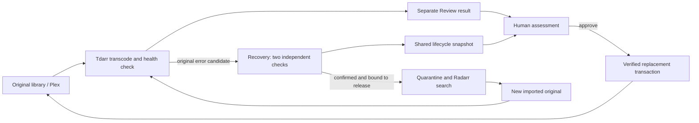

# Architecture and safety

Review is a Node HTTP server with no third-party JavaScript runtime dependencies. It reads Tdarr SQLite data and falls back to the existing Tdarr collection API for supported schemas. It calls FFprobe/FFmpeg for metadata and requested comparison samples. The browser receives no Radarr API key.

## Replacement transaction

Review stores transaction phases durably before continuing. The destination copy is verified against the Review result before replacing the original. File identities and Tdarr activity are checked again. The temporary old version and result are removed only after installation succeeds. A successful approval publishes evidence for the exact imported source and installed replacement.

On restart, only a provably untouched original can be restored automatically. Installed or ambiguous transactions remain for inspection; their journal and temporary files must not be discarded. Concurrent approvals, rejections, settings changes and preview operations are guarded by the server, not just disabled buttons.

## Automatic original recovery

The worker serializes heavy checks. It requires stable regular media, no active matching Tdarr job/result, unambiguous Radarr file/history binding and repeated matching recognized errors. Metadata fingerprints and sampled hashes must remain consistent. Sampling detects changes but is not a full-file health checksum.

After confirmation, it holds the old edition, preserves it outside the library, confirms Radarr no longer sees the old file and verifies exact release exclusion. It observes the replacement import and hands it to Tdarr. Unknown/interrupted mutation phases become manual rather than being blindly replayed.

When no replacement is available, automatic Recovery may return the protected original via hardlink or exclusive copy while keeping the edition excluded from Tdarr. Before a later download, it validates both identities and removes only that recorded library link/copy. The quarantined original remains until the retention conditions are met.

## Shared lifecycle

Recovery atomically publishes a versioned, allowlisted status file. It includes deferred limits, verification, quarantine, release exclusion, search/download, import and the replacement's Tdarr database state. It does not publish keys or unrestricted quarantine paths.

The worker normally waits five minutes between passes. A full original check can make a pass much longer; the public snapshot is not a live FFmpeg progress stream. Review polls and labels snapshots older than 12 minutes as stale. Database `Queued`/`Transcoding` status is not a per-worker percentage. This distinction avoids treating stale or missing state as completion.

## Quarantine retention

Seven days are counted from a verified Review approval of the identified replacement, not from download, import, job success or original quarantine time. Cleanup validates approval evidence, installed file identity, the recorded quarantine identity, containment, regular files, no symlinks and appropriate hardlink count.

Only recorded eligible files are removed; unrelated quarantine contents are not recursively deleted. Unapproved replacements, unknown identities and historical cases missing evidence stay preserved. They can therefore consume space until reviewed deliberately.

## Access boundaries

All application APIs require a Review session. Mutations check browser origin. Session cookies are HttpOnly and SameSite Strict. The provided containers drop capabilities, run as an unprivileged UID, use a read-only root filesystem, and do not mount the Docker socket.

Media write access is necessary for replacement. Mounting the media parent for quarantine gives the application access to that mounted share, not only one film directory. Keep the service on a trusted LAN; this version is not hardened or independently audited for direct public Internet exposure. See [Security](../SECURITY.md).
