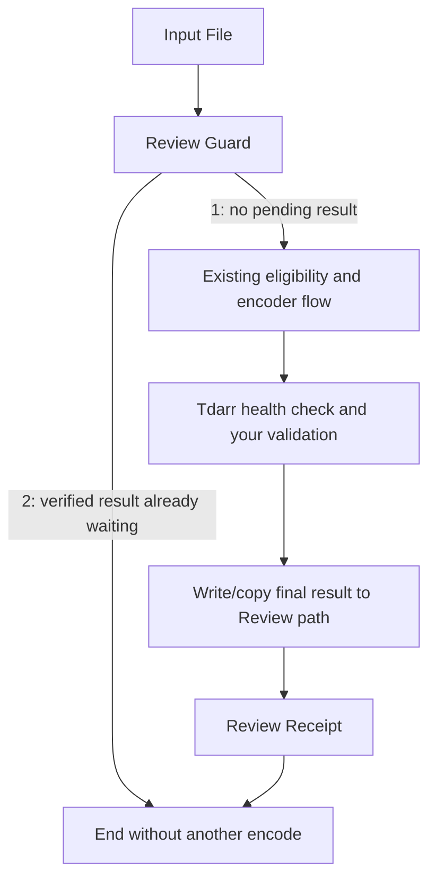

# Connect an existing Tdarr flow

This repository supplies the Review application and the optional Recovery worker. It does **not** export the entire personal encoding flow or install a universal HDR/codec policy. Keep your existing tested encoding, audio-language and health-check policy.

Required behavior: preserve the original in the Plex library, write the finished result to the separate Review tree, retain the relative film/file path, and run the intended Tdarr health check. Avoid a Tdarr step that replaces/deletes the original before Review approves it.

## Suggested flow placement



The examples under `examples/tdarr/` contain custom-function bodies adapted from the deployed integration. Edit the documented constants before using them. Use the code in the Tdarr **Custom Function** flow node; they are not Community plugin definitions or full flow JSON exports.

Guard runs before encoding. It captures source identity, detects destination collisions, and refuses to overwrite an existing result without verified receipt/history. Output 2 means the existing matching successful result is already awaiting Review, so skip encoding.

Receipt runs **after the final file is present at the configured Review path**. It checks the captured source is unchanged, records output identity and the actual Tdarr job ID. Running it before a copy/move to Review will fail. Use matching configuration in both examples, including Windows path translators and server library ID.

Server paths stored in Tdarr job history must stay server paths. On mapped Windows nodes, Tdarr can translate path literals in custom function inputs. The example constructs the history root from path components to avoid accidentally comparing a translated SMB path against server database paths.

## Receipt format

Place `Film.mkv.tdarr-receipt.json` alongside `Film.mkv`:

```json
{
  "version": 1,
  "relative": "Film/Film.mkv",
  "outputRelative": "Film/Film.mkv",
  "source": {"size": 1000, "mtime": 1700000000000, "sample": "sample SHA-256"},
  "output": {"size": 500, "mtime": 1700000000000, "sample": "sample SHA-256"},
  "jobId": "exact successful Tdarr job ID",
  "createdAt": 1700000000000
}
```

The example numbers are illustrative, not a valid real receipt. Receipt size and rounded mtime must match the current files. Review correlates library, source path, exact job ID when available, success and actual input/output sizes. Without a receipt, only unambiguous matching successful job evidence is accepted; ambiguous history is not guessed from the newest timestamp.

For TS/M2TS → MKV, `relative` remains the original TS/M2TS path and `outputRelative` is its MKV destination. Review requires an exact receipt for extension changes and refuses an already-existing MKV destination.

## Picture/profile compatibility

Review has validators for the deployed SDR/HEVC/HDR marker conventions, Dolby Vision 8.1, HDR10+, dual HDR and unchanged DV7 cases. These modules verify the corresponding implemented policies; they are not permission to blindly reencode every HDR film. A flow using a different marker convention may be blocked until adapted.

Do not convert DV7 FEL to a format that drops the enhancement layer while claiming full preservation. Do not treat MVC/stereo 3D or ISO images as ordinary 2D MKV. Such handling belongs to the encoding policy and remains outside this repository's automatic setup.

Original-language preservation must be part of the Tdarr audio/subtitle selection policy. CZ/EN-only filtering can remove a film's original dialogue. The optional Recovery metadata cache identifies original language via Radarr/TMDB; it is not itself a track filter or proof of the language actually spoken in a stream.

## Tdarr API compatibility

The integration uses existing `/api/v2/` routes for node state, pause updates, rescans, file updates and collection reads. It accepts plain-text `OK` mutation responses. After an uncertain Review replacement handoff, the application reads the exact file/library state before deciding whether another action is needed.

The deployed Rust engine was verified with the current API and SQLite schema. The API calls currently **do not attach a Tdarr authentication key**. An authenticated Tdarr API, or a future changed schema, requires an implementation/compatibility update. The Docker runtime's pinned image supplies Node/FFmpeg; it does not determine which engine your separate Tdarr server runs.
